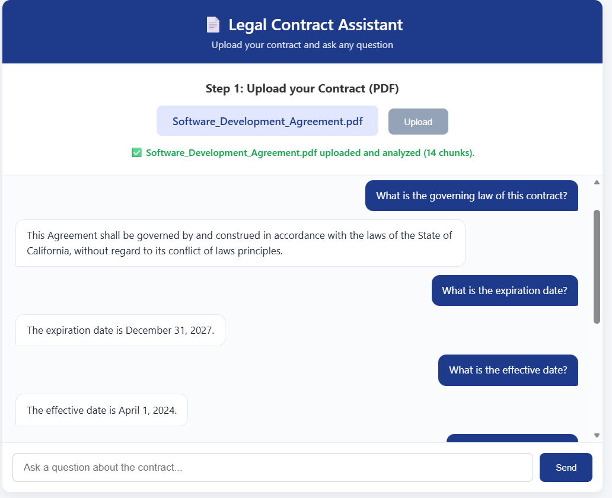
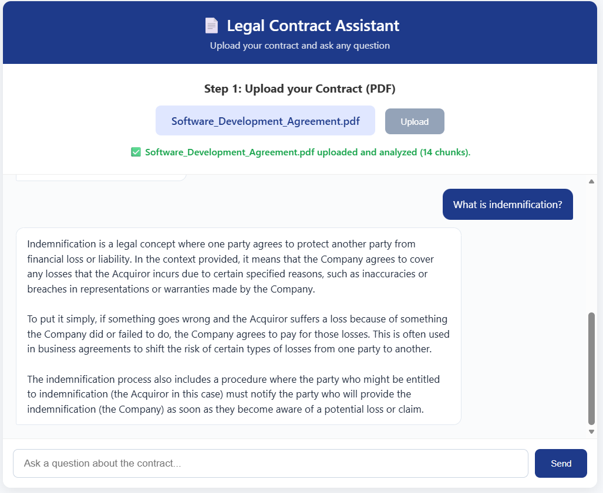
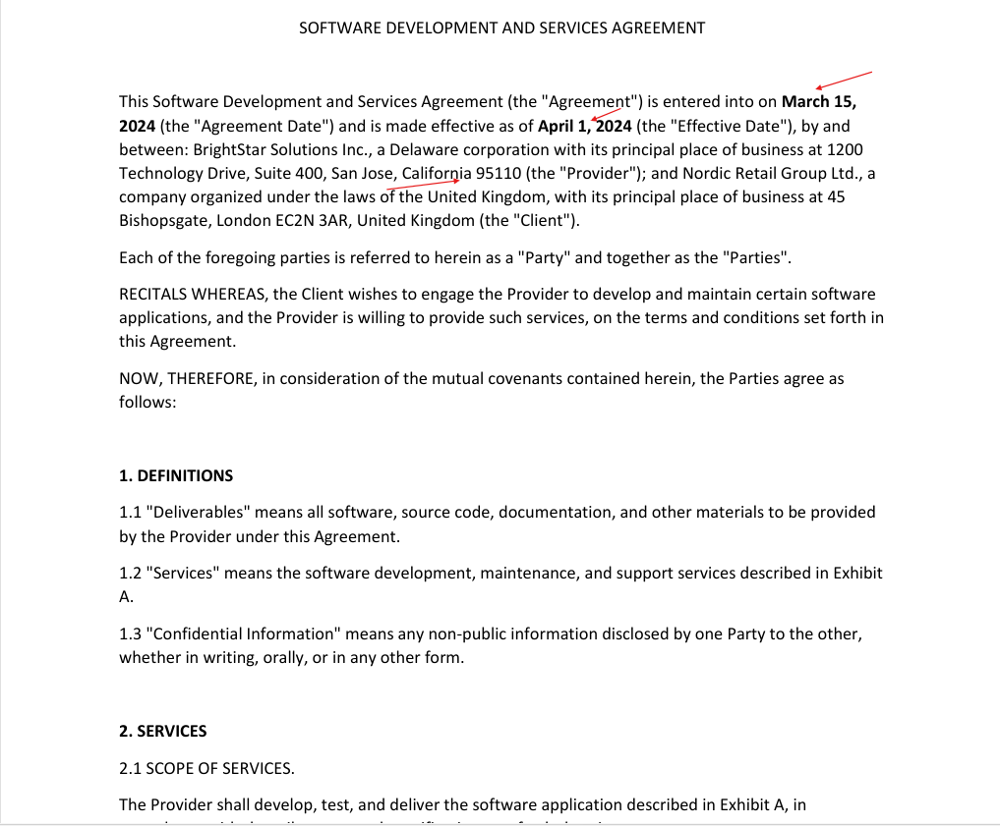

# Legal Contract RAG Assistant — Hybrid Retrieval-Augmented Generation for Contract Understanding

## Table of Contents

- [Overview](#overview)
- [Problem Statement and Goal](#problem-statement-and-goal)
- [Data](#data)
- [Methodology](#methodology)
  - [Pipeline Overview](#pipeline-overview)
  - [Phase 1 — Offline Ingestion of 510 Contracts](#phase-1--offline-ingestion-of-510-contracts)
  - [Phase 2 — Contract Upload and Preparation](#phase-2--contract-upload-and-preparation)
  - [Phase 3 — Hybrid Retrieval and Answer Generation](#phase-3--hybrid-retrieval-and-answer-generation)
- [Results](#results)

---

## Overview

This project is a **Retrieval-Augmented Generation (RAG) legal assistant** that helps non-lawyers understand contracts. The user uploads a contract in **PDF** format, and the assistant:

- **answers factual questions** (governing law, expiration date, payment terms, insurance requirements) by extracting the answer **directly from the uploaded contract**;
- **explains legal clauses in plain English** (indemnification, confidentiality, force majeure) by retrieving knowledge from an offline **corpus of 510 annotated commercial contracts** (the CUAD dataset).

The system implements a **hybrid retrieval architecture**: a keyword-based router decides, for each question, whether to search **the user's uploaded PDF** (for facts) or **the vector database of 510 contracts** (for concepts). This separation prevents the LLM from hallucinating facts, while still giving it access to a broad legal knowledge base for explanations.

The entire stack runs **locally** — the LLM is served by **Ollama**, the embeddings by **`sentence-transformers`**, and the vector store by **ChromaDB**. No data leaves the user's machine.

---

## Problem Statement and Goal

Contracts are long, dense, and written in specialized legal English. In practice:

- users **rarely read** the Terms of Service or contracts they sign;
- **abusive or risky clauses** go unnoticed;
- understanding a clause requires **prior legal knowledge** that most users do not have.

**Goal:** Build an automated, interpretable, and reproducible assistant that:

- extracts the **exact facts** from an uploaded contract (dates, amounts, jurisdictions, parties);
- **explains** any clause in **simple English**, grounded in real legal documents;
- never **invents** information: when a fact is not in the contract, the assistant must say so explicitly.

The pipeline is organized in **three phases** — offline ingestion, per-contract preparation, and hybrid retrieval — for a total of **11 sequential steps**, from raw contract text to a grounded answer displayed in a web interface.

---

## Data

### The CUAD Corpus (Offline Knowledge Base)

The assistant uses the **Contract Understanding Atticus Dataset (CUAD v1)** as its knowledge base for clause explanation.

| Parameter                   | Value                                           |
| --------------------------- | ----------------------------------------------- |
| Dataset                     | CUAD v1 (Atticus Project)                       |
| Number of contracts         | **510**                                         |
| Contract categories         | 25 (Licensing, Development, Franchise, …)       |
| Number of labeled clauses   | 41 categories                                   |
| Format used in this project | Plain text (`.txt`)                             |
| Source                      | EDGAR / U.S. Securities and Exchange Commission |

The 510 contracts span **25 types of commercial agreements** (license, development, distributor, franchise, hosting, manufacturing, outsourcing, supply, strategic alliance, transportation, etc.), with a wide variety of structures: some are strictly organized with `ARTICLE` and `Section 1.1`, others use only numbered headings like `1. PAYMENT`, and some are barely structured at all.

### Structure Diversity in Raw Contracts

A raw contract is **not a uniform document**. Three structural families are observed:

- **Fully structured contracts** — with clear `ARTICLE I`, `Section 2.1`, `Exhibit A`, `Schedule 1.1(b)` hierarchy.
- **Semi-structured contracts** — using only numbered headings (`1. DEFINITIONS`, `5. PAYMENT`) without formal sections.
- **Unstructured contracts** — where only the body text is present, sometimes with irregular line breaks, page numbers inserted mid-sentence, and `Source:` footer lines injected by the EDGAR export.

Because a **single regex cannot capture all three families**, the chunking strategy (Phase 1) combines **6 complementary regular expressions** and a **fallback segmentation** rule.

### The Test Contract (Used for the Demo)

A synthetic contract, _"Software Development and Services Agreement"_, was created to demonstrate the two retrieval modes. It contains a full set of factual anchors (dates, amounts, parties, insurance, arbitration, governing law) and is used in the figures below.

---

## Methodology

### Pipeline Overview

The pipeline is composed of **11 steps** organized into **three phases**:

1. **Offline ingestion** — build the vector database from the 510 CUAD contracts (steps 1–3).
2. **Contract upload and preparation** — parse the user's PDF and compute its embeddings once (steps 4–6).
3. **Hybrid retrieval and generation** — route the question, retrieve chunks, and generate the answer (steps 7–11).

The **hybrid routing** is the core originality of the pipeline: it explicitly separates **factual retrieval** (from the uploaded contract) from **conceptual retrieval** (from the 510-contract corpus).

---

### Phase 1 — Offline Ingestion of 510 Contracts

#### Step 1 — Text cleaning

Raw contracts contain **parasitic lines** injected by the EDGAR exporter: lines that contain only a page number, and footer lines that start with `Source:`. These lines are removed by a dedicated function `clean_document()` before chunking, according to the following rule:

- **Keep** a line `L` if and only if `L` is **not** composed only of digits **and** `L` does **not** start with `"Source:"`.
- **Discard** the line otherwise.

This step prevents page numbers and source footers from polluting the clause chunks.

#### Step 2 — Hierarchical regex-based chunking

Because contract structures vary widely, **no single regex is sufficient**. The chunker uses **6 complementary patterns**:

| Pattern                | Purpose                                   | Example                        |
| ---------------------- | ----------------------------------------- | ------------------------------ |
| `pattern_articles`     | Roman/arabic ARTICLE and Chapter headings | `ARTICLE VII`, `Chapter 3`     |
| `pattern_sections`     | Numbered sections and uppercase headings  | `Section 1.1`, `5. PAYMENT`    |
| `pattern_sub_sections` | Sub-sub-sections                          | `1.1.1`                        |
| `pattern_annexes`      | Annexes, Exhibits, and Schedules          | `Exhibit A`, `Schedule 1.1(b)` |
| `pattern_recitals`     | Preamble markers                          | `RECITALS`, `WHEREAS`          |
| `pattern_letters`      | Lettered sub-points                       | `(a)`, `(b)`, `(ii)`           |

The chunker then applies a **three-level hierarchical split**:

1. **Top-level split** on `ARTICLE | Chapter | Annex | Schedule | \n<number>. <UPPERCASE_TITLE>`.
2. **Preamble extraction** — everything before the first top-level heading is stored as a dedicated `PREAMBLE` chunk.
3. **Section-level split** inside each top-level chunk, using `Section X.Y` and `X.Y. <UPPERCASE>`.

#### Step 3 — Chunk size normalization and vector storage

Any chunk exceeding **2000 characters** is **re-split by sentence** into sub-chunks of approximately **1000 characters**, with the original heading preserved and suffixed `(suite i/N)`.

Each chunk is then embedded using **`all-MiniLM-L6-v2`** (384-dimensional vectors), and the resulting **25,772 chunks** are stored in a persistent **ChromaDB** collection named `cuad_contracts`.

---

### Phase 2 — Contract Upload and Preparation

#### Step 4 — PDF extraction

The user uploads a PDF via the web interface. The FastAPI backend extracts the text page by page using **`pdfplumber`**, which is more robust than `PyPDF2` on complex layouts (tables, multi-column) commonly found in legal documents.

If the PDF contains no extractable text (a scanned contract), the API returns a **400 error** with an explicit message, instead of silently returning an empty answer.

#### Step 5 — Per-contract chunking

The extracted text is passed through the **same `chunk_contract` function** used in Phase 1. This guarantees **structural consistency** between the offline corpus and the uploaded document.

Each chunk is stored as a tuple `(header, body)`, and the body is embedded **once** using the batch `embed_documents` method.

#### Step 6 — In-memory session storage

The prepared contract — `{chunks, headers, embeddings}` — is stored in a **Python dictionary indexed by `session_id`**. This eliminates the 30–60 second embedding cost from subsequent questions and allows multiple users to query **independent contracts** simultaneously.

---

### Phase 3 — Hybrid Retrieval and Answer Generation

#### Step 7 — Query routing

For each question, the router decides **which source to query**. The current implementation uses a **keyword-based classifier** with a curated list of factual markers:

$$
\mathrm{is\_factual}(q) \;=\; \exists\, k \in \mathcal{K}_{\text{fact}} \; : \; k \subseteq \mathrm{lower}(q)
$$

where $\mathcal{K}_{\text{fact}}$ contains terms such as `date`, `expiration`, `governing law`, `jurisdiction`, `payment`, `amount`, `party`, `notice`, `signature`, `arbitration`.

- **Factual question** → search the **uploaded contract**.
- **Explanatory question** → search the **ChromaDB corpus**.

This design choice is deliberately conservative: the assistant prefers to miss a factual question (and fall back on a general explanation) rather than hallucinate a fact that is not in the contract.

#### Step 8 — Similarity retrieval

**Factual branch:** the question is embedded with `embed_query`, and the **cosine similarity** is computed against each contract chunk. Because embeddings are normalized (`normalize_embeddings=True`), the cosine similarity reduces to a **dot product**:

$$
\text{sim}(q, c) = \mathbf{q} \cdot \mathbf{c} = \sum_{i=1}^{384} q_i \, c_i
$$

The **top 5 chunks** are selected.

**Explanatory branch:** `ChromaDB.similarity_search` is used directly. ChromaDB internally indexes the 25,772 vectors with **HNSW**, reducing the search from a linear scan to a logarithmic query.

#### Step 9 — Context assembly

The 5 retrieved chunks are concatenated with an explicit delimiter (`\n\n---\n\n`) to make them visually distinct to the LLM. This prevents the LLM from merging unrelated clauses into a single sentence.

#### Step 10 — Prompt construction

Two distinct prompts are used, matching the two retrieval modes:

- **`template_pdf`** — _"Answer the question based ONLY on the contract text provided below. If the answer is not in the contract, say 'This information is not found in the contract.'"_ — the strict instruction prevents hallucination.
- **`template_chroma`** — _"Explain the legal concept clearly and simply in English, based only on the context below."_ — the softer instruction allows pedagogical synthesis.

#### Step 11 — LLM generation via Ollama

The prompt is passed to **Qwen 2.5 7B** served by **Ollama** with `temperature=0.1`. The low temperature enforces **factual precision** for the legal domain. The response is parsed to a plain string by `StrOutputParser` and returned as JSON to the web interface.

---

## Results

The pipeline was tested on the synthetic _"Software Development and Services Agreement"_ contract, and on the 510-contract CUAD corpus.

### Factual Retrieval — Answers Extracted from the Uploaded Contract

Three factual questions were asked. In all three cases, the answer was extracted **verbatim** from the uploaded PDF, with the correct value and the correct legal context.

_Figure 1 — Factual retrieval. The questions "What is the governing law?", "What is the expiration date?", and "What is the effective date?" are answered using only the uploaded contract. The assistant returns the exact legal phrase (California law) or the exact date (December 31, 2027 / April 1, 2024)._

### Explanatory Retrieval — Answer Synthesized from the ChromaDB Corpus

A conceptual question was asked to validate the explanatory branch of the pipeline. The answer is a **pedagogical explanation**, drawn from examples found in the 510-contract corpus — not from the uploaded contract.

_Figure 2 — Explanatory retrieval. The question "What is indemnification?" is routed to ChromaDB. The LLM synthesizes a plain-English explanation of the concept, with an example of a notification procedure._

### Ground-Truth Verification

To confirm that the factual answers were **not hallucinated**, the source text of the contract was compared with the answers returned by the assistant. Every extracted value (governing law, expiration date, effective date) matches the corresponding clause of the uploaded document.

_Figure 3 — Ground-truth verification. The three factual answers returned by the assistant (California law, December 31, 2027, April 1, 2024) are highlighted in the source contract._

### Quantitative Summary

| Metric                                              | Value                                       |
| --------------------------------------------------- | ------------------------------------------- |
| Contracts ingested (CUAD)                           | 510                                         |
| Contracts successfully chunked                      | 499 (11 skipped, Windows path-length limit) |
| Total chunks indexed in ChromaDB                    | **25,772**                                  |
| Embedding dimension                                 | 384                                         |
| ChromaDB file size                                  | 162 MB                                      |
| Average factual retrieval score (top-1)             | 0.22 – 0.45                                 |
| Factual answer precision (demo contract, 3 queries) | 3 / 3 correct                               |
| Explanatory answer quality (qualitative)            | ✓ pedagogically correct                     |

---
